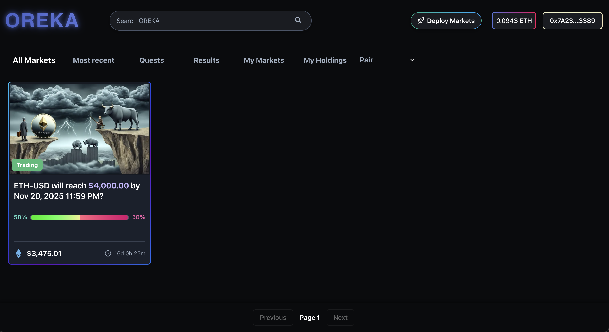

# Oreka Multi-Chain Binary Option Market

## Features

- Create binary option markets for any trading pair
- Support for Chainlink and LLM oracles
- Bid on Long or Short positions
- Automatic market resolution using real-time price data
- Claim rewards when a market resolves in your favor

## Deployment Addresses

### 0G Galileo Testnet
- **LLM Factory**: `0xB8C396d35db7673e09Bd053098FAEc52Fc2e51C9`
- **Chain ID**: 16602 (0x40da)
- **RPC URL**: `https://evmrpc-testnet.0g.ai`



## App Flow

### Market Creation Flow
1. **Select Oracle Type**: Choose between Chainlink (traditional) or LLM (AI-powered) oracle
2. **Configure Market**: Set trading pair, strike price, maturity time, and fee percentage
3. **For LLM Markets**: Provide oracle wallet address authorized to resolve markets
4. **Deploy**: Contract is deployed via factory (Chainlink) or LLM Factory (LLM markets)

### Trading Flow
1. **Bidding Phase**: Users place bids on Long (price >= strike) or Short (price < strike)
2. **Market Resolution**: 
   - **Chainlink**: Automatic resolution via Chainlink price feeds
   - **LLM**: Oracle service queries LLM via 0G Network and calls `resolveWithPrice()`
3. **Reward Claiming**: Winners claim rewards proportional to their bid amount

## Running the Frontend

### Prerequisites
- Node.js 16+ and npm
- MetaMask or compatible wallet
- Testnet ETH for transactions

### Quick Start

1. **Navigate to frontend**:
   ```bash
   cd evm-frontend
   ```

2. **Install dependencies**:
   ```bash
   npm install --legacy-peer-deps
   ```

3. **Start development server**:
   ```bash
   npm run dev
   ```

4. **Open browser**:
   - Navigate to `http://localhost:3000`
   - Connect your wallet
   - Switch to 0G Galileo Testnet (Chain ID: 16602)

### Environment Variables (Optional)

Create `.env.local` in `evm-frontend/`:
```env
NEXT_PUBLIC_LLM_FACTORY_ADDRESS=0xB8C396d35db7673e09Bd053098FAEc52Fc2e51C9
NEXT_PUBLIC_ORACLE_API_URL=http://localhost:4000/api
```

## Running the Oracle Service (0G Chatbot)

The oracle service is required for resolving LLM-based markets. It uses the 0G Network to query LLM models for price data.

### Prerequisites
- Node.js 16+ and npm
- Private key with testnet ETH (for 0G Network transactions)
- Access to 0G Galileo Testnet

### Quick Start

1. **Navigate to oracle service**:
   ```bash
   cd 0g-chatbot
   ```

2. **Install dependencies**:
   ```bash
   npm install
   ```

3. **Set up environment variables**:
   Create `.env` file in `0g-chatbot/`:
   ```env
   PRIVATE_KEY=your_private_key_here_without_0x_prefix
   PORT=4000
   NODE_ENV=development
   ```

4. **Build the project**:
   ```bash
   npm run build
   ```

5. **Start the server**:
   ```bash
   npm start
   ```
   
   Or for development with hot reload:
   ```bash
   npm run dev
   ```

6. **Access the service**:
   - **REST API**: http://localhost:4000
   - **Swagger UI**: http://localhost:4000/docs
   - **Web Chat Interface**: http://localhost:4000/chat

### Oracle Service Features

- **LLM Market Resolution**: Automatically resolves markets by querying LLM models via 0G Network
- **REST API**: Provides endpoints for market resolution
- **Web Chat Interface**: Interactive interface for testing LLM queries
- **Automatic Payment Processing**: Handles 0G Network payments for AI queries

### Oracle API Endpoints

#### `POST /api/oracle/resolve-market`
Resolve an LLM-based market using LLM price data.

**Request:**
```json
{
  "marketAddress": "0x...",
  "tradingPair": "ETH/USD",
  "providerAddress": "0x..." // Optional: 0G provider address
}
```

**Response:**
```json
{
  "success": true,
  "transactionHash": "0x...",
  "price": "4000.50",
  "timestamp": 1234567890
}
```

See [0g-chatbot/README.md](./0g-chatbot/README.md) for complete API documentation.

## Work-In-Progress 🚧

- **Liquidity Tree AMM Design Diagram**
```
                                  +-------------------+
                                  |   Liquidity Tree  |
                                  |   AMM for Markets |
                                  +-------------------+
                                           |
                          +----------------+---------------+
                          |                                |
              +-----------v------------+      +-----------v------------+
              |    Liquidity Pool      |      |   Prediction Markets   |
              |  (Single Token Pool)   <----->|   (Betting Conditions) |
              +-----------+------------+      +-----------+------------+
                          |                                |
      +-------------------+-------------------+            |
      |                   |                   |            |
+-----v------+     +-----v------+     +------v-----+      |
|   Leaf 1   |     |   Leaf 2   |     |   Leaf 3   |      |
| (LP Node)  |     | (LP Node)  |     | (LP Node)  |      |
+-----+------+     +-----+------+     +------+-----+      |
      |                   |                   |            |
      |                   |                   |            |
+-----v------+     +-----v------+     +------v-----+      |
| Liquidity  |     | Liquidity  |     | Liquidity  |      |
| Provider 1 |     | Provider 2 |     | Provider 3 |      |
+------------+     +------------+     +------------+      |
                                                          |
                          +-------------------------------|
                          |                               |
               +----------v-----------+      +------------v-----------+
               |  Market Resolution   |      |   Outcome Settlement   |
               | (Oracle Resolution)  |      | (Profit/Loss Handling) |
               +----------------------+      +------------------------+
```

## License

MIT License - see LICENSE file for details.
